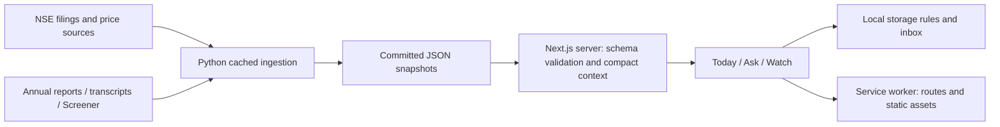

# FINN — Investor desk

A mobile-first filter for financial filings, with a saved NSE digest, configurable
alerts and primary-source research. The committed snapshot runs without API keys.

## The Desk Terminal UI

Ink and paper editions use locally hosted Newsreader, Inter Tight and JetBrains Mono.
Try these first: tap a portfolio heat tile to filter Today; change Watch thresholds and
replay the inbox; open a statement's exact sources in Ask. Press `/` or Ctrl/Cmd+K to
search companies. Settings includes theme, density, default window, optional haptics and a short guide.
Filing sheets support snap controls and Back; Watch supports archive/undo. Additional
research lenses show saved trajectory, balance-sheet fields, business passages and
mechanical bull/bear comparisons. Voice follow-ups appear where the browser supports them.

[Today, ink](docs/ui-after/r5-today-ink-390x844.png) ·
[Today, paper](docs/ui-after/r5-today-paper-390x844.png) ·
[Statement ledger](docs/ui-after/r5-ask-ink-390x844.png) ·
[Alert instrument panel](docs/ui-after/r5-watch-ink-390x844.png) ·
[Source drawer](docs/ui-after/r5-sources-ink-390x844.png).

Visual rounds, viewport matrices and performance reports are under `docs/ui-after/`;
recorded browser sessions are under `docs/demo/`. See `docs/UI_REVIEW.md` for measured
results and the source-availability and browser-support boundaries.

## Run

Requires Node 22+ and Python 3.11+ only for optional ingestion.

```sh
corepack pnpm@12.16.1 install --frozen-lockfile
npm run dev
```

For a production demo:

```sh
npm run build
npm start
```

The server listens on port 3000. On your own network, open your computer's address
on a phone; PWA installation and service workers require HTTPS except on localhost.
Live prototype: **https://enam-holdings-bay.vercel.app/**.
The repository is connected to Vercel; main-branch commits trigger deployment. The snapshot requires no secrets.
Live unknown-ticker ingestion requires Python and does not run on Vercel.

## Try it

- Today: change 24h/3d/7d/30d, filter by company/category, expand a filing, pin or mute it.
- Ask: select INFY, WIPRO or HCLTECH; compare explicit guidance to later disclosures.
  Tap a source passage; switch to Financial snapshot, Guidance or Cash quality.
- Watch: adjust thresholds, inspect the historical preview, run a check twice, reload.
  The inbox persists and duplicate replay entries are suppressed.
- Load the app online once, wait for service-worker activation, then reload Today,
  Ask and Watch offline. Saved research remains available. Original external PDFs
  and new-company ingestion require network access. First-ever offline visits cannot work.
- Triple-tap the logo for snapshot cost diagnostics. Missing tickers stay unavailable.

## Validation

```sh
npm test
npm run typecheck
npm run lint
npm run build
```

The completed build passed Linux production build, strict typecheck, lint and 51 unit tests. Chromium QA
covered 390×844 and 1440×1000 routes, source drawers, persisted/deduplicated alerts,
unknown ticker state and offline reload of all three main routes. See
[QA evidence](docs/qa/README.md), [decisions](DECISIONS.md), and [handoff](CLOUD_HANDOFF.md).
Screenshots: [Today](docs/qa/01-today-mobile.png), [Ask](docs/qa/02-ask-mobile.png),
[Watch](docs/qa/03-watch-mobile.png), [Sources](docs/qa/04-sources-mobile.png),
[Desktop](docs/qa/05-today-desktop.png).

## Data and architecture



Snapshot timestamps stay visible; the digest clock follows the latest saved filing
(1 November 2026). Math, classification, alerting and current research comparisons
run deterministically. Every research source opens its exact saved passage. Derived
EBITDA uses PBT + interest + depreciation - other income; rounded inputs and exceptional
items limit comparison. PAT may include non-controlling interests. See the three-filing
manual reconciliation in DECISIONS.md; full reconciliation is not claimed.

Raw source data is retained under data/. Compact retrieved pages feed the initial UI;
the deployed HTML was measured at approximately 494 kB uncompressed, with saved research
loaded through the precached snapshot endpoint. Field performance is not certified.

## Optional refresh and providers

```sh
python -m venv /workspace/finn-venv
/workspace/finn-venv/bin/pip install -r pipeline/requirements.txt
/workspace/finn-venv/bin/python pipeline/refresh_all.py
./node_modules/.bin/tsx pipeline/precompute.ts
```

Refresh can change committed snapshots: inspect the diff. Downloads reuse content-hash
caches; FORCE_REFRESH=1 refetches. Sources may return 403 or be unavailable. In cloud,
allow required upstream hosts in environment settings before refreshing. Do not disable
TLS or invent missing data. Set PYTHON_BIN to the venv Python for local API ingestion.

.env.example lists optional LLM_PROVIDER, LLM_API_KEY, LLM_CHEAP_MODEL and
LLM_STRONG_MODEL. Keep keys out of Git. Gemini is the adapter default; Groq,
OpenRouter, Anthropic and OpenAI adapters are present. Routing intends cheap extraction
and strong cross-document reasoning; arithmetic never uses a model. Adapters and live
provider cost tracking are not integrated into this deterministic demo. Measured demo
model spend: $0, zero model tokens, not a forecast of refresh costs.

No BSE fallback, management biography enrichment, web push, account sync or live scheduler
is implemented. Additional research lenses are limited to saved quarterly series, disclosed
balance-sheet fields, exact business passages and mechanical bull/bear comparisons. Promise scoring is a limited statement-based
heuristic, not a judgment of management. Actual conversation share links accompany the submission.
